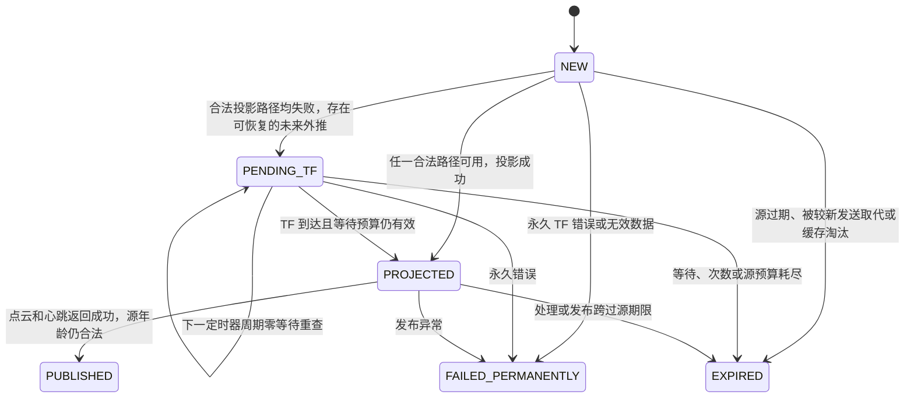

# T3：VOA Bridge 有界 TF 重试开发报告

本轮只在开发虚拟机实现、测试，未连接 Jetson、部署、启停机器人节点或发送控制指令。实际基线为 `master@bdc18a0c4495a92fa6b79731e3968676e2867b2c` 加工作区已有 T2.2 埋点及 T2.4 回调组修改。修改前 Bridge SHA-256 为 `ef7a96efd2a70a082186db6f7b693e808f0a4d7dea64d26db6820541d5276f5b`。原有未提交修改全部保留。

## 1. 修改前的实际行为

`Bridge.receive()` 原来保存最多 16 条原始 GridMap；`publish()` 每 25 ms 从最新候选和轮转的较早后缀中选择至多 4 帧。精确 `map ← base_link` TF 不可用时，继续尝试注册位姿锚点，以及锚点时刻、栅格时刻的 `robot_odom ← leg_base_link` TF。

旧代码已经支持跨定时器再次尝试，不能描述成“GridMap 到达时 TF 不可用就一定丢帧”。它缺少逐帧等待状态、固定等待截止、尝试次数限制及完整失败分类：缓存中的永久失败也可能不断被尝试，终结帧仍占缓存，发布部分失败后也没有独立的发送顺序栅栏。

本次不把旧版已有的恢复能力计为 T3 新增收益。

## 2. 修改文件

| 文件 | 修改内容 |
| --- | --- |
| `scripts/voa_costmap_bridge.py` | 候选状态、TF 分类、有界跨周期重试、清理、发布顺序及诊断 |
| `tests/test_voa_tf_retry.py` | 新增 52 项确定性 Mock、发布保护、实际速度门代码及 Foxy 调度语义测试 |
| `tests/test_voa_tf_retry_stress.py` | 新增 3 项压力测试，以及可复现的修改前/后比较程序 |
| `tests/test_voa_costmap_bridge.py` | 既有 Mock 改用预期 TF 异常，并同时模拟单调秒和纳秒时钟 |
| `tests/test_voa_projection_freshness.py` | 为原有模拟时钟补齐 `monotonic_ns()` |
| `tests/test_voa_callback_groups.py` | Foxy 调度夹具补齐同一时钟域的纳秒读数 |
| 本文 | 实现边界、结果、风险和后续验证步骤 |

仅一个业务文件发生本轮变更。没有修改腿部 TF Bridge、motion_receiver、原厂 VOA、velocity_gate、Nav2、DDS、NDT 或任何 YAML 配置。

## 3. 候选帧状态机



`Candidate` 保存在原来的 `deque(maxlen=16)` 中，不另设消息队列。每帧记录原始整数纳秒时间戳、首次接收单调时间、首次 TF 失败时间、最近尝试时间、固定截止、尝试次数、状态、最后 TF 异常和 TF 就绪时间。

终结候选及时移出队列；只保留一份末次终结事件的标量诊断快照，不保留第二份 GridMap 数据缓存。成功发布更新的源时间戳后，较早候选终结为 `EXPIRED/candidate_superseded`。

## 4. 新鲜度和等待预算

必须区分以下限制：

| 检查 | 实际含义 | 保持值 |
| --- | --- | --- |
| GridMap 接收 `fresh()` | 当前单调时间减原始源时间；不是接收间隔 | `[-0.05, 0.5] s` |
| Bridge 发布源年龄 | 计算完成及发布阶段使用原始源时间 | 最大 `0.35 s` |
| velocity_gate VOA 心跳 | 当前单调时间减最后接受的源时间 | 最大 `0.5 s` |
| Bridge `publish_gap_s` | 距最后一次完整发布完成多久 | 诊断量，不替代源年龄 |
| `input_receive_age_s` | 距最近收到 GridMap 多久 | 诊断量，不重置源年龄 |

速度门没有在这条 VOA 路径使用新的 0.35 秒接收年龄门槛；0.35 秒是 Bridge 的更严格发布源年龄上限。

默认试验参数：

```text
tf_retry_max_wait_ms = 150
tf_retry_processing_reserve_ms = 100
tf_retry_max_attempts = 8
```

8 次包含第一次尝试，最多再尝试 7 次。它们是 Bridge 重试策略，不是新的速度门安全期限。

首次完整投影失败时，计算：

```text
remaining_budget = 0.35 - current_source_age - 0.100
effective_wait <= min(0.150, remaining_budget)

retry_deadline_ns = min(
    first_tf_failure_ns + 150_000_000,
    original_source_stamp_ns + 250_000_000
)
```

后一个式子利用已验证的 Jetson 单调传感器时钟域，避免读取秒、纳秒之间发生抢占时意外延长期限。首次失败从实际最早 TF 异常处取时，包含随后尝试其他锚点消耗的时间。以后重试不重置截止。

源年龄 40 ms 时，最多等待 150 ms；源年龄 200 ms 时，最多剩约 50 ms；源年龄已达到 250 ms 后不再等待 TF。每次重试前及 TF 返回后重新检查预算和固定截止。达到处理预留边界即停止重试；150 ms 的等待边界在源预算仍充足时可以成功。

无需等待、TF 已立即合法可用的新帧仍按原 0.35 秒规则处理；预留参数不把所有直接投影强制收紧到 0.25 秒。解码后、点云调用后、心跳调用后仍检查源年龄，跨界不提交完整成功状态。

历史 T2.2/T2.4 日志保留下来的 `process_s` 样本最大约 34.789 ms，`publish_s` 样本最大约 9.412 ms。100 ms 大于这些稀疏样本，适合作为保守起点，但样本不是逐帧完整分布，不能据此声称覆盖全部尾延迟。真实 Jetson CPU 曾约 94%，必须验证实际处理耗时。

## 5. TF 查询、分类与回退

全部 `lookup_transform()` 继续只传 target、source、原始查询时间三个参数，使用原有默认零等待行为；不增加 `Duration`、睡眠、Future 等待、线程或 ROS 接口。

| 分类 | 最终处理 |
| --- | --- |
| 预期 TF 异常中的 Future Extrapolation | 合法路径都未成功时，进入有界 `PENDING_TF` |
| Past Extrapolation | 当前路径不可恢复；继续检查其他原有合法路径 |
| LookupException | 保守按当前帧的坐标系缺失处理，不为它无限等待 |
| ConnectivityException | 记录坐标树问题，继续检查其他合法路径 |
| 其他预期 TF 异常 | 保留类型和文本，当前路径不安排无依据的重试 |
| 非 TF 程序异常 | 不因文本含 “future” 就重试，保留错误并终结当前候选 |

只有所有投影路径均失败后才对整个候选作决定。精确 NDT 尚未就绪时，合法锚点补偿仍立即优先完成；不等待精确 NDT 而阻止腿部补偿。精确 NDT 历史不足但腿部路径未来外推时，也允许腿部路径稍后恢复。

锚点差 `0～0.5 s`、腿部跨度、平移不超过 `0.5 m`、旋转不超过 `0.35 rad` 及矩阵组合全部保持原样。查询失败仍向现有 T2.2 Probe 提供原始异常，分类不替代原始证据。

## 6. 调度、去重和线程边界

保留最新候选优先、较早后缀轮转回退、每周期最多 4 个不同候选。每个候选每次 `publish()` 至多尝试一次，不添加重复候选。同源重复或倒序输入仍被接收端拒绝。

理论每周期 TF 查询上界仍为 `4 × (1 + 2 × 12) = 100`，实际上锚点前置查询失败时更少。缓存清理仅扫描最多 16 个候选；无无限循环或无界等待。

保留三个业务回调共用的 `MutuallyExclusiveCallbackGroup`、独立 TF Listener 的 `ReentrantCallbackGroup`、两个 Executor 工作线程、原 RLock 和 25 ms 定时器。

单次零等待查询和几何计算仍在原业务 RLock 内同步执行。这里“等待不持锁、不占 Executor 线程”是指 `PENDING_TF` 的周期之间：函数返回并释放锁和工作线程，后续定时器再尝试。它不表示整个投影函数已经后台化，也不是 TF Listener 的专属线程保证。真实 CPU 饥饿或 TF2 内部短时互斥仍可能带来延迟。

## 7. 有效发布、空帧和顺序保护

只有以下步骤全部完成才更新 `last_published`、`last_publish_time`、发布计数及恢复计数：

1. 指定时间的精确 TF 或原有有界补偿合法。
2. 栅格解码和坐标投影成功。
3. 原始源年龄满足 0.35 秒限制。
4. 点云发布调用返回成功。
5. 心跳发布调用返回成功，最终源年龄仍合法。

TF 失败和等待时不发点云、不发心跳、不更新有效时间。几何处理只在 TF 就绪后进行，TF 重试不会多算一次有效观测。合法空栅格仍发零点点云和原始源时间心跳；未知格仍按原有保守约束投影。

点云或心跳发布异常继续传播，不吞掉异常。候选终结，不作为 TF 重试重新发送。新增 `last_cloud_attempt_stamp_ns` 只是一道发送顺序栅栏：发布调用可能已交给 DDS，即使异常也禁止再次发送该源或回退发送更旧源。它不表示数据有效，不参与速度门新鲜度，不刷新有效心跳。

无法从 Python 发布 API 保证 DDS 送达时刻或撤回已交给 DDS 的消息。若调用期间跨过期限，本地不再提交成功，且不伪造源时间；不能将此表述为对网络送达时间的硬实时保证。

## 8. 障碍物短时连续性

Factory Only 使用 `scripts/make_dynamic_nav2_config.py::voa_layer()`，并非直接沿用地图 YAML 中旧 LiDAR 层。当前 VOA STVL 参数保持：

```text
voxel_decay = 1.5
decay_model = 0
observation_persistence = 0.0
expected_update_rate = 0.5
marking = true
clearing = false
clear_after_reading = true
```

TF 缺帧不会产生清空输入。既有 voxel 按 STVL 原有衰减策略保留、衰减；`clear_after_reading` 消费观测缓存不等于主动清空整张代价地图。本次没有增加障碍记忆缓存、旧点云重发或新的清除计数。

这不能保证障碍永久保留：1.5 秒衰减仍然存在，速度门仍可在源心跳过期时停车。离线测试验证了配置及 Bridge 不发假空帧，未实际运行 STVL，真实地图持久化仍需后续实机验证。

## 9. 离线测试结果

最终共 215 项相关测试通过：本次新增 55 项、Foxy 回调组测试 15 项、Factory 配置测试 5 项、原有 T2.2/Bridge/速度门及视觉回归 140 项。

本次 55 项包括用户提出的 37 类场景，并追加了截止取时抢占、最后允许尝试成功、混合 TF 路径、发送部分失败、发送过程中超龄、原始时间戳变化、诊断异常及持续流压力边界。实际速度门测试使用原 `velocity_gate.py` 和完全模拟的 Node/Publisher，未初始化真实 ROS，也未调用 ROS 服务。

Foxy 线程测试复用冻结的真实 CallbackGroup、Task、Executor handler 和线程池派发代码，Node/RMW 就绪由 Mock 提供；不是仅用 Python 锁代替 Executor 语义。

原环境首轮 `check_t22.sh` 有一项已有视觉错误文本测试失败：该 Mock 子进程限制为 0.3 秒，未及时输出异常栈即被终止。视觉脚本和测试的 SHA-256 均与本轮前一致，独立运行也复现。只读检查发现 Ubuntu `apport_excepthook` 会在原异常输出前加载报告模块；临时 `/tmp` Python 包装器仅对 stdin Mock 片段采用 `-S` 隔离 site/apport，保持 0.3 秒测试期限不变，同一测试随后在 0.037 秒通过，完整回归也通过。没有修改系统设置、视觉代码、测试文件或任何安全期限。原失败、隔离脚本及最终成功日志均保留。

单独运行本次功能测试：

```bash
cd /home/duyipei/Lite3_Projects/lite3_patrol_project/tests
OPENBLAS_NUM_THREADS=1 OMP_NUM_THREADS=1 PYTHONDONTWRITEBYTECODE=1 \
  python3 -B -m unittest -v test_voa_tf_retry test_voa_tf_retry_stress
```

## 10. 修改前/后压力比较

基线是本轮修改前实际保存的 T2.4 Bridge，不切换 Git 历史。每场景 30 秒模拟时间，40 Hz 投影定时器，通常 30 Hz GridMap、20 Hz 腿部 TF、10 Hz 注册锚点；使用 120×80 栅格、原几何函数。显式模拟解码 2 ms、两次发布共 0.4 ms；没有真实等待、ROS、DDS 或 Jetson 调度。

| 场景 | 修改前投影 Hz | T3 投影 Hz | T3 完整失败后恢复帧/失败候选 | 恢复等待平均/P95 ms | T3 队列峰值 |
| --- | ---: | ---: | ---: | ---: | ---: |
| 35 ms 传输延迟 | 19.97 | 19.97 | 299/600 | 25/25 | 2 |
| 35～98 ms 传输抖动 | 17.97 | 17.97 | 419/780 | 46.42/75 | 4 |
| 200 ms 传输延迟 | 19.87 | 9.93 | 298/900 | 150/150 | 6 |
| 持续 TF 断流 | 0 | 0 | 0/900 | 无成功样本 | 6 |
| 80 Hz GridMap、65 ms 传输 | 19.97 | 19.97 | 599/2398 | 75/75 | 10 |

恢复率分母是整条投影路径曾失败的不同源帧，不是仅精确 NDT 失败，也不是独立导航故障。部分候选被更新观测取代，模拟结束时也可能仍有待处理候选，不能要求该比例为 100%。旧版在前三个正常延迟场景也能跨定时器恢复，因此吞吐持平、不能声称 T3 新增了全部恢复能力。

全部场景队列不超过 16、每周期候选不超过 4、重复几何处理与重复发布均为 0，点云/心跳调用时源年龄均不超过 350 ms，定时器返回后没有遗留业务锁。

35～98 ms 场景 T3 源年龄平均/P95/最大为 91.042/125.334/125.334 ms，与修改前持平；心跳间隔 P95/最大为 75/75 ms。200 ms 场景因固定等待上限弃帧 597 帧，持续断流弃帧 895 帧；上述场景没有通过放宽源年龄来维持发布。源过期、处理预算耗尽等其他弃帧原因在单元测试中单独覆盖。

200 ms 场景投影频率下降是实测到的限制，不掩盖、不通过放宽参数消除。当前默认值不能保证处理所有 200 ms 延迟。Future Extrapolation 调用次数也可能增加，不能用该计数是否为零判断改造成功。

CPU 有额外管理成本：例如抖动场景本地加速脚本 CPU 消耗约 289.36 → 355.75 ms，80 Hz 场景约 347.71 → 471.63 ms；这些包含 Mock、消息构造、统计及真实 NumPy 计算，不是 Jetson CPU 百分比。当前 VM 这次抖动测试的定时器墙时 P95 约 0.611 ms，不能推广为实机承诺。

可复现比较：

```bash
cd /home/duyipei/Lite3_Projects/lite3_patrol_project
OPENBLAS_NUM_THREADS=1 OMP_NUM_THREADS=1 PYTHONDONTWRITEBYTECODE=1 \
  python3 -B tests/test_voa_tf_retry_stress.py \
  --baseline /path/to/saved_before_bridge.py \
  --duration 30 --output /tmp/t3_stress_new_id.json
```

输出文件采用独占创建，不覆盖旧结果。不要以“禁用 T3”替代真实修改前源码进行比较。

## 11. 参数入口和诊断

新参数使用 Bridge 命令行选项，不写入原厂 VOA YAML、不增加 ROS 通信协议：

```text
--tf-retry-max-wait-ms 150
--tf-retry-processing-reserve-ms 100
--tf-retry-max-attempts 8
```

参数校验：等待 0～350 ms（0 表示关闭重试），处理预留大于 0 且小于 350 ms，尝试次数整数 1～64。实际截止始终被源年龄减预留限制，不随参数延长速度门期限。原启动器未修改，默认参数自然生效；未来调整参数的部署方式需要单独审查。

现有每 5 秒诊断保留原字段，并增加 `candidate_states`、`last_candidate_event` 及重试、恢复、等待超时、源预算耗尽、次数耗尽、淘汰、取代、发布失败等有界计数。恢复等待累计和最大值只在完整成功发布后更新，不在高频回调内计算分位数。

## 12. 产物和完整 diff

本轮结果目录：

`/home/duyipei/Lite3_T3_results/20261105_192322_5c2f6b/`

最终压力结果以 `stress_verified.json` 为准；较早试验文件仅作过程留档。目录保存最终测试日志、测试环境隔离说明、修改前 Bridge、范围与哈希核对、Python 语法结果、完整本轮 `task_changes.patch`，以及相对 Git HEAD 的 `git_diff.patch`。

`task_changes.patch` 以本轮开始时的实际脏工作区为基线，包含本轮新增测试与本文。相对 HEAD 的 Git diff 还包含之前未提交的腿部诊断修改，两者应明确区分；本轮没有修改腿部业务源码，没有暂存、提交、分支操作或推送。

## 13. 后续实机 DISARMED 验证：需单独授权

1. 审查本轮 diff、确认文件哈希及回滚副本，再授权部署唯一业务文件；本轮没有执行部署。
2. 操作者在诊断标记创建后加载新节点，全程保持 DISARMED、不发目标；保留原 T2.2 采集工具。
3. 连续 2～3 轮 45 秒，比较候选恢复数、固定截止弃帧数、尝试次数上界、源年龄、投影频率、心跳最大间隔、CPU、Listener 延迟与 dropped_rows。
4. 重点检查 `retry_source_budget`、`tf_wait_timeout`、`processing_expired`、`publish_expired`，确认处理预留够用、无旧源发布或伪造心跳。
5. 观察已有障碍在短 TF 缺口期间的 STVL 行为、真实空帧以及自然衰减；静止通过不等于运动下通过。

实际 CPU 调度、TF2 内部同步及 DDS 送达仍未验证。本次没有证明历史 0.5 秒过期停车的唯一根因已消除。

## 14. 后续受控导航验收：需另外确认

静止数据审查通过后，由操作者独立确认定位、短目标路径、障碍摆放、遥控急停及现场条件，再授权运动测试。比较直行空地、有障碍绕行和短暂自然 TF 缺口下的数据年龄及投影连续性。

持续无有效投影时，速度门继续按原始源年龄超过 0.5 秒触发保护，故障恢复后仍需人工 CLEAR/ARM；Mock 已验证零速、锁存及不自动 ARM。原定时器和操作系统调度不提供硬实时停车时刻保证，不能把逻辑阈值当作实机最坏停车延迟。本轮没有执行运动验收或人为中断真实节点。
